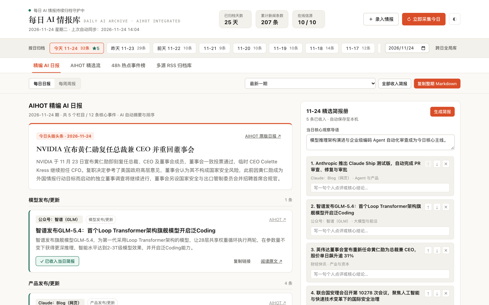
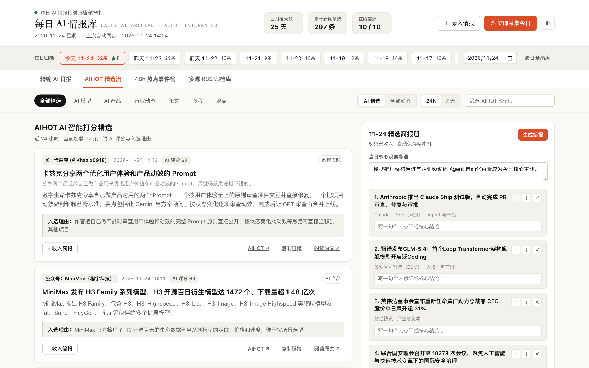
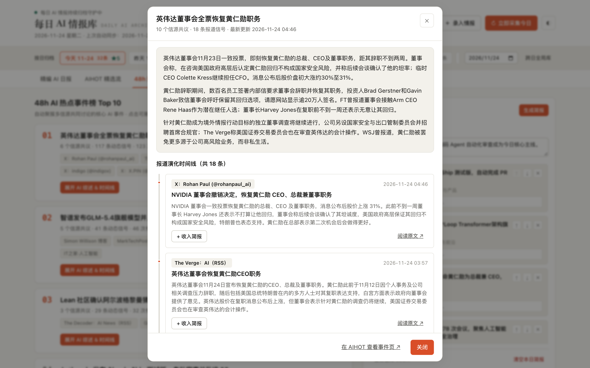
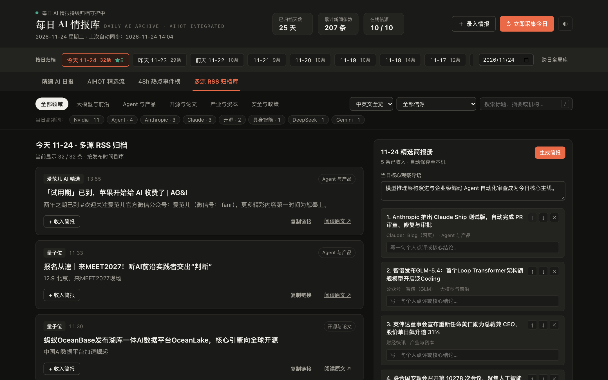
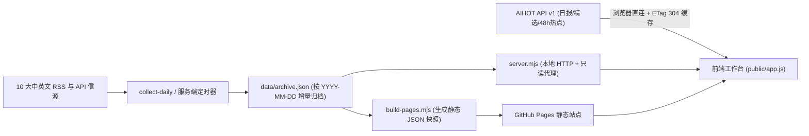

# 每日 AI 情报库 · Daily AI Archive

> **一屏看尽当日全球 AI 精编日报、48h 热点事件脉络、智能评分精选，以及 10 大中英文信源的按日增量归档。**

- 🌐 **在线访问（GitHub Pages）**：https://eason-xi.github.io/daily-ai-news/
- 📦 **GitHub 仓库**：https://github.com/Eason-Xi/daily-ai-news
- ⚡ **零依赖架构**：纯原生 Node.js（`>= 20`）+ 原生 HTML/CSS/ES Module，无需 `npm install`，开箱即用。

---

## 界面预览

### 1. 精编 AI 日报 & 个人简报收集册（浅色纸张主题）
首屏默认展示每日头版头条导读与分栏目精编列表；支持切换往期日报或每周周报，一键将重点条目收入右侧「当日精选简报册」，填写核心观察导语与点评批注后导出排版精美的 Markdown 或社群快讯。



### 2. AIHOT 智能打分精选流
按 `AI 精选` / `全部动态` 与 `24h` / `7 天` 时间窗过滤，提供 6 大垂直分类与关键词实时筛选；每条资讯附带 **AI 质量评分**、中英双语对照标题与 **AI 入选理由**。



### 3. 48h 热点事件榜 & 深度综述时间线
自动聚簇过去 48 小时内多信源共同讨论的 Top 10 核心 AI 事件，点击任意热点即可弹出多段式 **AI 事件综述**与完整 **报道演化时间线**，并支持将单条报道收入今日简报。



### 4. 多源 RSS 按日归档库 & 信源雷达（深色石墨主题）
内置浅色纸张与深色石墨双色主题；支持通过顶部按日时间轴或日历选择器回顾任一历史日期的 10 源采集归档，也可一键进入「跨日全局库」进行跨天关键词搜索（快捷键 `/` 聚焦搜索）。



---

## 核心功能详解

### 1. 四大主视角协同工作台
| 视角 | 核心能力 | 适用场景 |
| :--- | :--- | :--- |
| **精编 AI 日报** | 展示每日头版头条、分栏目清单及每周周报；支持与顶部时间轴日期双向联动、一键「复制整期 Markdown」与「全部收入简报」 | 晨间 3 分钟速览全网今日核心动态 |
| **AIHOT 精选流** | 按 `24h / 7d`、6 大领域（模型/产品/行业/论文/教程/观点）过滤，附 AI 质量打分、双语标题与入选理由 | 高信噪比挖掘高价值技术/产品信号 |
| **48h 热点事件榜** | 聚合多信源讨论热议的 Top 10 AI 事件；弹窗展示多段式事件综述与报道时间线 | 追踪重大事件来龙去脉与各方表态 |
| **多源 RSS 归档库** | 按日分桶沉淀 10 大官方信源；支持五维分类（大模型/Agent/开源论文/产业资本/安全政策）、中英文筛选与当日高频词胶囊 | 按天检索原始一手资讯与历史归档 |

### 2. 个人精选收集箱与 URL 智能提取
- **按日独立简报册**：每一天都有专属的「精选简报册」与「当日核心观察导语」，支持逐条编写个人点评、上移/下移调整排序。
- **粘贴链接智能录入**：点击右上角 **「＋ 录入情报」**，粘贴外部文章 URL 并点击 **「智能提取」**，服务端自动解析网页 `og:title` / `description` / 来源站点并推荐分类（自带内网与非法协议 SSRF 防护）。
- **多格式成稿导出**：支持一键预览、复制与下载 **`AI日报-YYYY-MM-DD.md`**、微信/飞书 **社群快讯纯文本**，以及 **全库历史 JSON 备份**。

### 3. 内置 10 大自动采集信源矩阵

| 信源名称 | 语言 | 协议类型 | 默认分类 | 采集策略与单篇校验 |
| :--- | :---: | :--- | :--- | :--- |
| **Hacker News AI** | 英文 | Algolia JSON API | 开源与论文 | 实时检索 AI/LLM/主流实验室相关高赞讨论 |
| **Hugging Face Papers** | 英文 | Daily Papers JSON | 开源与论文 | 拉取每日热门研究论文与摘要 |
| **arXiv cs.AI** | 英文 | RSS 2.0 | 开源与论文 | 同步人工智能领域最新预印本论文 |
| **OpenAI News** | 英文 | RSS 2.0 | 大模型与前沿 | 官方新闻与研究发布 |
| **TechCrunch AI** | 英文 | RSS 2.0 | 产业与资本 | 硅谷创投、融资估值与商业报道 |
| **The Verge AI** | 英文 | RSS 2.0 | Agent 与产品 | 前沿消费级产品与行业新闻 |
| **WIRED AI** | 英文 | RSS 2.0 | 大模型与前沿 | 深度科技评论与产业分析 |
| **MIT Tech Review AI** | 英文 | RSS 2.0 | 大模型与前沿 | 麻省理工科技评论 AI 专题报道 |
| **量子位** | 中文 | RSS 2.0 | Agent 与产品 | 国内前沿模型、开源项目与具身智能资讯 |
| **爱范儿 AI 精选** | 中文 | RSS 2.0 | Agent 与产品 | 基于双语 AI 关键词精确过滤的中文科技报道 |

> 所有采集文章均经过 `isDeepArticleUrl()` 单篇深层链接校验与 `normalizeUrl()` 去追踪参数去重，确保每条点击「阅读原文」直达具体单篇文章，拒绝媒体首页或频道聚合页混入。

---

## 技术架构与三模运行机制



前端应用会根据访问环境**自动无感切换**三种运行模式：

| 运行模式 | 触发条件 | 数据来源与存储方式 |
| :--- | :--- | :--- |
| **本地全栈模式** | 运行 `npm start` 访问 `http://127.0.0.1:3456` | 后端每 30 分钟后台自动采集写入 `data/archive.json`；支持服务端网页 Meta 提取与个人简报磁盘持久化；提供 `/api/aihot` 白名单只读代理兜底 |
| **GitHub Pages 云端归档模式** | 访问线上 `https://<user>.github.io/<repo>/` | 读取 GitHub Actions 定时构建的 `api-static/*.json` 归档快照 + 浏览器直连 AIHOT 实时数据；访客手动录入与批注保存在浏览器 `localStorage` |
| **离线纯静态模式** | 直接双击打开 `public/index.html`（`file://`） | 加载内置种子快照并支持浏览器直连 Hacker News API 与 AIHOT API，个人数据保存在 `localStorage` |

---

## 快速开始

### 环境要求
- **Node.js `>= 20.0.0`**（零第三方 npm 依赖，无需执行 `npm install`）

### 常用命令

```bash
# 1. 启动本地全栈服务（默认监听 http://127.0.0.1:3456）
npm start

# 如需指定其他端口
PORT=8080 npm start

# 2. 手动执行一次全源增量采集并更新 data/archive.json
npm run collect

# 3. 构建 GitHub Pages 纯静态站点与静态 JSON 接口（输出至 _site/）
npm run build:pages

# 4. 运行自动化单元测试与端到端 API 闭环测试
npm test
```

---

## 项目目录结构

```text
.
├── .github/workflows/
│   └── daily-ai-news.yml      # GitHub Actions：每日 3 次定时采集、自动提交、测试与 Pages 部署
├── data/
│   ├── archive.json           # 按 YYYY-MM-DD 增量去重存储的每日新闻归档库
│   └── seed-daily.json        # 经核验的初始多日真实单篇报道种子数据
├── docs/screenshots/          # README 展示高清实机截图
├── lib/
│   ├── archive-store.mjs      # 原子读写、历史清洗与按日分桶归档存储引擎
│   ├── rss-parser.mjs         # RSS/Atom 解析、HTML 清洗、五维分类与深层 URL 校验
│   └── sources.mjs            # 10 大信源并发采集器（单源超时隔离、近 30 天窗口过滤）
├── public/
│   ├── aihot-client.js        # AIHOT API v1 客户端（支持内存 TTL + ETag 304 复用）
│   ├── app.js                 # 多视角前端逻辑、三模自适应与简报生成器
│   ├── index.html             # 语义化页面结构与原生弹窗
│   └── styles.css             # 瑞士报刊质感浅/深双色主题样式
├── scripts/
│   ├── build-pages.mjs        # GitHub Pages 静态包与 api-static/*.json 生成脚本
│   └── collect-daily.mjs      # CLI 与 Actions 使用的每日增量采集脚本
├── tests/
│   └── aggregator.test.mjs    # 覆盖解析、分类、去重、API 代理、构建与 HTTP 闭环的测试套件
├── package.json
├── README.md
└── server.mjs                 # 零依赖 Node HTTP 服务、SSRF 安全提取与后台定时采集器
```

---

## Fork 与一键云端部署指南

如果你想拥有一个完全属于自己的云端自动更新版「每日 AI 情报库」：

1. 点击本仓库右上角 **Fork** 到你自己的 GitHub 账号。
2. 进入你 Fork 后的仓库 **Settings → Pages**：
   - 将 **Build and deployment → Source** 设置为 **`GitHub Actions`**。
3. 进入仓库 **Actions** 页面，开启 Workflow 权限并手动运行一次 **`Daily AI News Collect & Deploy Pages`**（选择 `Run workflow`）。
4. 之后工作流会在每天北京时间 **08:00、13:00、20:00** 自动运行全网采集、提交新增数据到 `data/archive.json`，并自动重新部署你的 GitHub Pages 站点。

---

## 数据来源致谢与合规说明

- 本项目的精编日报、每周回顾、AI 智能打分精选流及 48h 热点事件综述接口由 **[AIHOT (aihot.news)](https://aihot.news/)** 公开只读 API v1（见其 [`llms.txt`](https://aihot.news/llms.txt)）提供。遵循 AIHOT 公开使用规则，**本项目仅将其作为客户端按需实时查询展示（带 ETag 条件缓存与完整署名回链），不将其内容转储镜像至公开仓库，仅供个人非商业学习与日常阅读使用**。
- 各 RSS/API 新闻与论文版权归原媒体或作者所有，页面所有卡片均保留原出处署名与原文直达链接。
